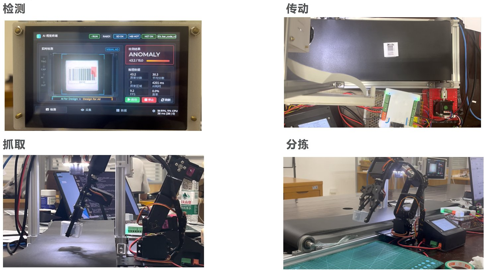
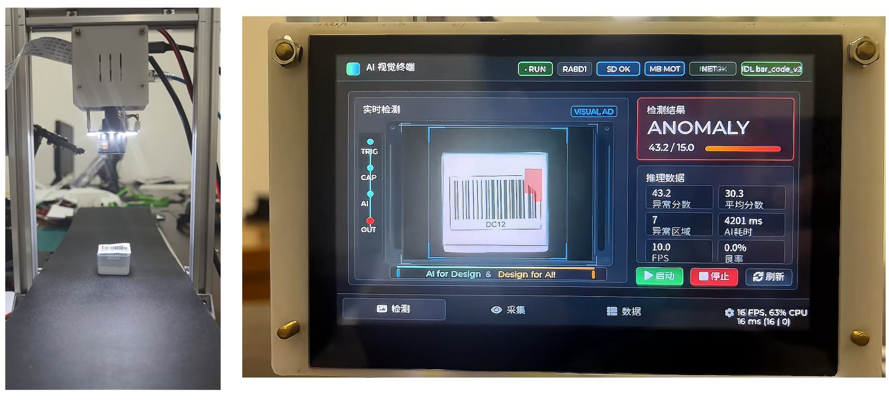
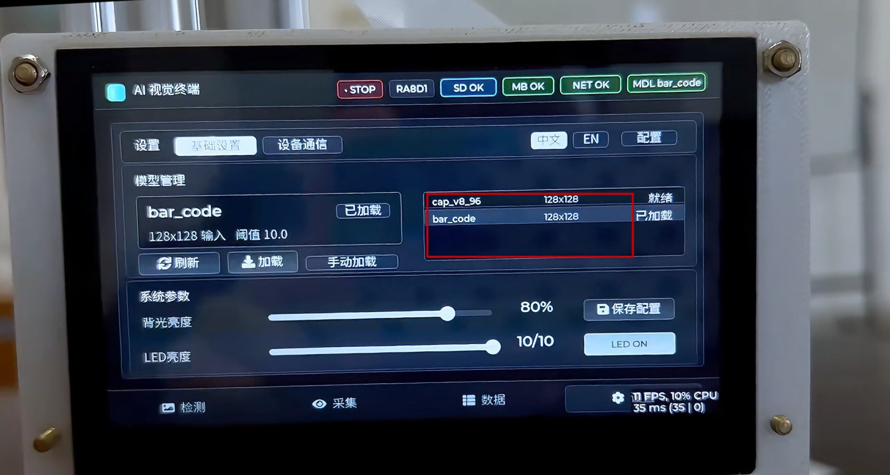
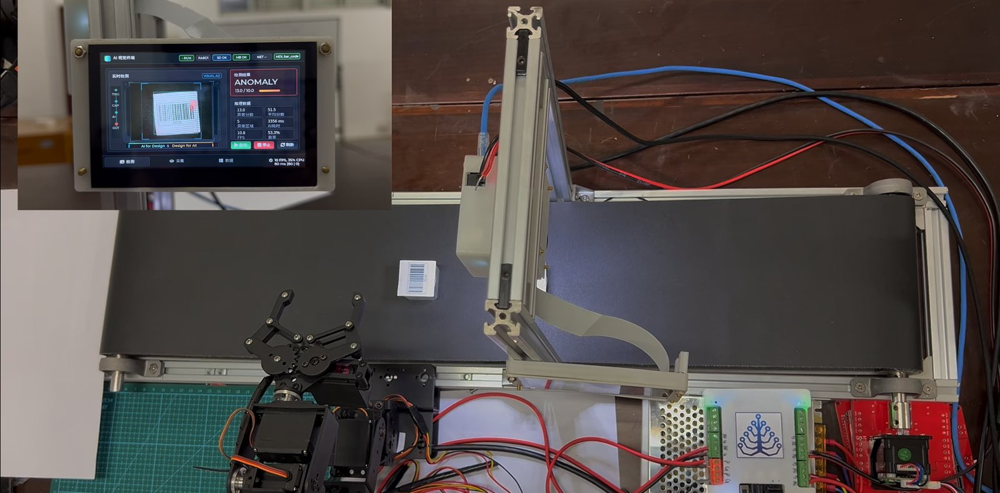
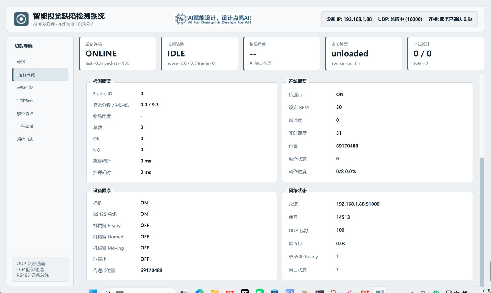
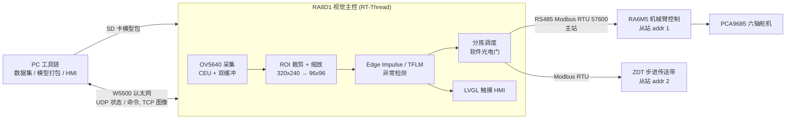

# RA8D1 边缘 AI 视觉检测与自动分拣系统

基于瑞萨 **RA8D1（Cortex-M85）+ RA6M5（Cortex-M33）** 的双芯片产线演示系统：工件随传送带进入采集区，视觉终端在端侧完成图像采集与异常检测，通过 RS485 / Modbus RTU 调度机械臂把不良品分拣出去，上位机通过以太网实时监控设备与产线状态。

> 2026 年全国大学生嵌入式芯片与系统设计大赛 · 芯片应用赛道瑞萨方向 **国家级三等奖**



| 检测出缺陷 | 模型热加载 |
|---|---|
|  |  |
| **终端检测结果** | **上位机总览** |
|  |  |

## 系统架构



**RA8D1 负责感知与决策，RA6M5 负责执行，PC 负责配置与管理。**

## 技术要点

**视觉终端（`firmware/vision_board`，RT-Thread + LVGL + FSP）**
- 采集、推理、显示、通信拆分为独立线程，通过 completion / 信号量同步；推理使用拷贝帧，与采集双缓冲隔离。
- I2C 配置 OV5640，CEU（DVP）采集配合 D-Cache 维护；单帧采集带超时保护，超时即停止 CEU 并上报错误。
- 移植 Edge Impulse SDK + TFLM（CMSIS-NN），张量 arena 放入独立 SRAM 段；96×96 模型 AI 后端耗时约 **180 ms**。
- 基于 SDHI + 文件系统读取模型包并做兼容性校验，空闲态 **模型热切换**，无需重新烧录。
- 软件光电门：在 ROI 内检测工件越线，触发一次检测，NG 时下发分拣动作。
- 工业链路：固件内 16 位保持寄存器镜像作为 UI / msh / Modbus 的统一数据源，寄存器表见 [`industrial_link_register_map.md`](firmware/vision_board/docs/industrial_link_register_map.md)。
- W5500 以太网：UDP 状态上报（16000）、UDP 命令、TCP 图像回传。

**机械臂控制（`firmware/arm_controller`，裸机 FSP）**
- 静态任务表的协作式调度器，所有任务非阻塞。
- Modbus RTU 从站、TJC 串口屏、手动调试三路控制源统一汇入 `arm_control` 命令层，`command_seq` 作幂等键；舵机输出统一走 µs 目标值 / 当前值模型并按关节限位。
- PCA9685 驱动六轴舵机，关节标定与坐标系见 [`硬件资源表.md`](firmware/arm_controller/硬件资源表.md)。

**PC 工具（`firmware/vision_board/pc_tools`，Python）**
- `vision_pc_hmi.py`：Qt 上位机，设备发现、状态总览、远程控制。
- `vision_dataset_tool.py`：把板端 RGB565 BMP 按与固件完全一致的 ROI / 缩放转成训练集。
- `ei_model_pack.py`：把 Edge Impulse C++ 导出打包为 SD 卡模型包。

## 目录结构

```
firmware/
├── vision_board/        RA8D1 视觉主控
│   ├── APP/             业务模块（每个模块 INIT_APP_EXPORT 自启动 + msh 命令）
│   ├── board/           板级移植、相机驱动、LVGL UI
│   ├── Components/      Edge Impulse SDK、W5500 驱动
│   ├── ra/ ra_gen/ ...  瑞萨 FSP（由 configuration.xml 生成）
│   ├── rt-thread/ packages/ libraries/   RT-Thread 内核、LVGL 等第三方
│   ├── pc_tools/        上位机与数据工具
│   └── docs/            寄存器表、模型热切换 SOP
└── arm_controller/      RA6M5 机械臂控制
    ├── APP/ src/        调度器与业务模块
    └── HMI/             TJC 串口屏工程
```

## 构建

**视觉终端**：使用 RT-Thread Studio 导入 `firmware/vision_board`，或在 RT-Thread Env 中执行 `scons -j12`（`scons --target=mdk5` 可生成 Keil 工程）。首次烧录如 SWD 被锁，按住 RST 启动下载后松开，或用 Renesas Flash Programmer。

**机械臂控制**：Keil MDK 5（armclang，需安装 Renesas RA DFP）打开 `firmware/arm_controller/Robotic_Arm_Control.uvprojx` 编译；FSP 配置用 `rasc_launcher.bat` 打开 `configuration.xml`。

**PC 工具**：

```bash
python -m pip install -r firmware/vision_board/pc_tools/requirements.txt
python firmware/vision_board/pc_tools/vision_pc_hmi.py
```

板端调试主要通过 msh 命令行，例如 `camera_test`、`detect_app_once_cmd`、`model_scan`、`model_load <name>`、`modbus_stat`。

## 许可

本仓库自研代码以 MIT 许可发布；`ra/`（瑞萨 FSP）、`rt-thread/`、`packages/`、`Components/edge_impulse_*` 等第三方代码遵循各自目录中的原许可。
